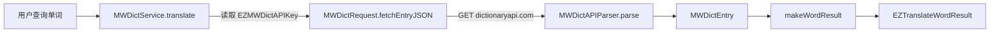

# 韦氏词典服务设计

- 状态：adopted
- 初次记录：2026-11-09
- 最近更新：2026-11-09

## 背景

Merriam-Webster（韦氏）是常用的英英词典。其网站 `merriam-webster.com` 由 Cloudflare
托管，任何非浏览器客户端（`curl`、`URLSession`）都会收到 403 挑战页，浏览器会话之外的
抓取不可行；官方 `dictionaryapi.com` 提供同一部 Collegiate 词典的 JSON 数据，但需要
免费 API Key。

因此本服务与必应词典服务采用不同的取数路径：必应解析匿名可得的服务端 HTML，韦氏调用
官方 API。两者的渲染目标一致——原生词典卡片，内容与顺序尽量贴近官网。

## 设计目标

- 以独立服务类型 `MerriamWebster` 接入，不影响既有服务。
- 使用官方 API 与用户自备的免费 Key，不保存 Cookie。
- 纯原生渲染，不注入 WebView HTML。
- 卡片结构与官网一致：词性 → 发音 → 词形变化 → 动词分节（及物/不及物）→ 编号与字母
  义项及例句 → 派生词 → 同义词 → 首次使用年份 → 词源。
- 解析器只依赖 Foundation，可用固定 JSON 单测。

## 数据流

## 组件职责

### `MWDictRequest`

- `GET https://dictionaryapi.com/api/v3/references/collegiate/json/{word}?key={key}`。
- ephemeral `URLSession`：不落 Cookie、不缓存；查询值与 Key 使用严格白名单编码。
- 401/403 映射为“Key 无效或过期”，其余非 2xx、空响应与网络错误映射为 `QueryError`；
  取消错误原样抛出。

### `MWDictAPIParser`

- 输入为 JSON 数组：对象是词条，字符串数组是拼写建议（返回 `nil`，表现为无结果）。
- 只取第一条词条（同形异义词的第一条），词头取自 `meta.id` 并去掉 `:1` 同形编号。
- 词形变化取自 `ins`（`de*vel*oped` 去掉 `*`），缺失时回退 `meta.stems` 并去掉词头、去重。
- 释义遍历 `def[].sseq`：`sense`/`bs` 为义项，`pseq` 为括号子义项；编号规则见下。
- 定义文本 `dt` 支持 `text` 与 `vis`（例句）；`sdsense` 以 `; 分隔词 …` 续写；
  `uns` 为用法说明（官网在箭头 `→` 之后展示），其文本与例句一并保留。
- 同义词优先取 `syn_list` 的 `wd`，否则从同义词辨析段落 `pt` 中提取 `{sc}…{/sc}` 词头。
- 派生词取自 `uros`（`ure` + `fl`），如 `developable adjective`。
- 运行文本标记（`{bc}`、`{it}`、`{wi}`、`{sx|…}`、`{dxt|…}`、`{dx_def}…{/dx_def}` 等）
  统一转换为纯文本。

### `MWDictService`

- 服务类型 `.merriamWebster`，名称 `merriam_webster`，`apiKeyRequirement = .userProvided`，
  `hasPrivateAPIKey` 由 `EZMWDictAPIKey` 是否为空决定。
- 语言边界：auto / 英语 / 简体中文 / 繁体中文；仅接受英文单词（允许连字符与撇号）。
- `wordLink` 指向官网词条页。
- 设置页通过 `ServiceConfigurationSecretSectionView` 提供 API Key 输入。

## 义项编号规则

API 在每条序列的首个义项给出完整编号（`1 a`、`2 a`、`4`），后续义项只给字母（`b`、`c`），
括号子义项给 `(1)`、`(2)`。解析器维护“当前主编号 + 当前字母标签”：

- `2 a` / `4`：更新主编号，直接使用。
- `b` / `b (1)`：补主编号，得 `2 b` / `2 b (1)`。
- `(2)`：补当前字母标签，得 `2 b (2)`。

## 渲染映射

`makeWordResult` 按官网顺序输出 `EZTranslatePart`：

1. 词性（仅当各分节没有动词分节标签时，如形容词条目显示 `adjective`）。
2. 词形变化：单独一行 `developed; developing; develops`（不加标签，避免模型把单词标签
   转成缩写形式）。
3. 每个动词分节：分节名单独一行（`transitive verb` / `intransitive verb`），随后每个义项
   一行（标签为编号，正文为定义），每条例句单独一行（`— …`）。
4. 派生词（`developable adjective`）。
5. 同义词写入原生 `synonyms` 字段，渲染为可点击按钮。

用法说明以 `→ …` 续写于定义之后；`First Known Use` 与 `Etymology` 不展示。

### 整句例句（Learner's Dictionary）

官网「Examples of … in a Sentence」整句例句来自 Learner's Dictionary（另一订阅）。服务在
Collegiate 结果之外，额外以 `learners` 引用拉取整句例句，并在存在时追加「Examples in a
Sentence」区块；未订阅该引用时接口返回错误文本，区块静默省略，不影响 Collegiate 卡片。

发音写入 `EZWordPhonetic`（首个发音，`US`）。

## 取舍

- **官方 API 而非抓取网页**：网站被 Cloudflare 拦截，非浏览器客户端无法访问；API 提供同一
  部词典的结构化数据，代价是需要用户自备免费 Key。
- **只取第一词条**：同形异义词（如 `run:1`、`run:2`）只显示第一条，与官网首屏一致，避免
  卡片过长。
- **同义词从辨析段落提取**：Collegiate API 不返回 `syn_list` 时，用辨析段落中的加粗词头
  近似，保持可点击同义词；词库 API（Thesaurus）未接入。
- **词形变化用 `ins`**：`meta.stems` 含派生词（`developable`），`ins` 才是官网展示的
  变形行。

## 已知限制

- 需要免费 API Key；未配置时服务不查询，卡片提示配置。
- 仅英文单词；多词短语与非英文输入返回无结果。
- 仅第一词条；例句数量随 API 返回，不额外展开。
- 官网整句例句需 Learner's Dictionary 订阅；未订阅时仅展示 Collegiate 自带例句。
- `First Known Use` 与 `Etymology` 按用户要求不渲染。

## 验证

- `EasydictTests/Service/MWDictAPIParserTests.swift`：8 个用例覆盖词头/词性/发音/词形、
  动词分节与编号（含 `2 b (1)`）、同义词/首次使用/最佳译文、纯文本、拼写建议返回 `nil`、
  标记转换，以及服务层 part 顺序与原生同义词字段。
- `xcodebuild test`：韦氏与必应共 19 项用例通过。
- 真实 API（develop / run / happy）逐项对照官网：分节、编号、例句、派生词、首次使用、
  词源一致。
- 运行中应用 HTTP `/translate` 与窗口截图核对：原生卡片按官网顺序渲染。

## 重新评估条件

- API 响应结构变化或 Key 策略变化。
- 需要同形异义词、例句展开或 Thesaurus 词库数据。
- 需要离线或免 Key 的韦氏数据来源。
